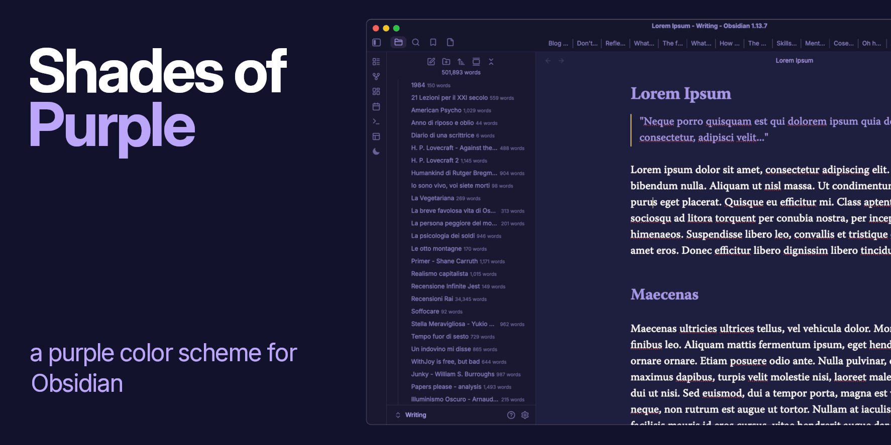
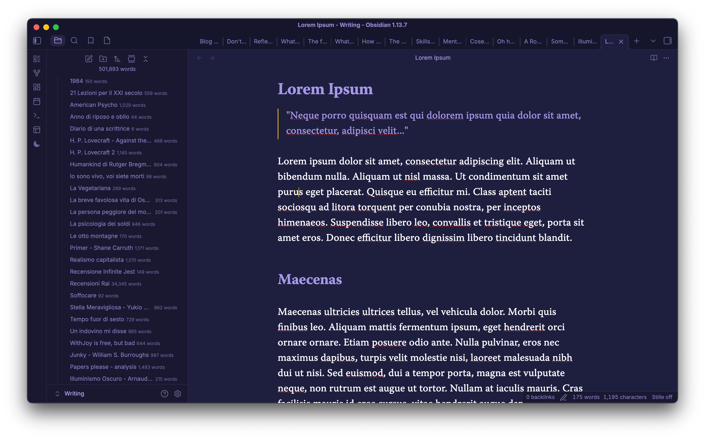

# Shades of Purple

A dark-only Obsidian theme that adapts the default interface to the official
[Shades of Purple](https://github.com/ahmadawais/shades-of-purple-vscode) color
palette by Ahmad Awais.

The theme uses the Super Dark background (`#1E1E3F`) as its only appearance.
It preserves Obsidian's standard layout, component styling, and typography, so
your configured interface and fonts remain unchanged.

## Screenshots

## Palette

| Purpose | Color |
| --- | --- |
| Background | `#1E1E3F` |
| Foreground | `#A599E9` |
| Contrast | `#FAD000` |
| Light contrast | `#FFEE80` |
| Comments | `#B362FF` |
| Constants | `#FF628C` |
| Keywords | `#FF9D00` |
| Cyan | `#9EFFFF` |
| Strings | `#A5FF90` |
| Bright green | `#3AD900` |
| Definitions | `#FB94FF` |
| Highlight | `#FF7200` |

## Attribution

The palette is from Ahmad Awais's MIT-licensed
[Shades of Purple for VS Code](https://github.com/ahmadawais/shades-of-purple-vscode).
